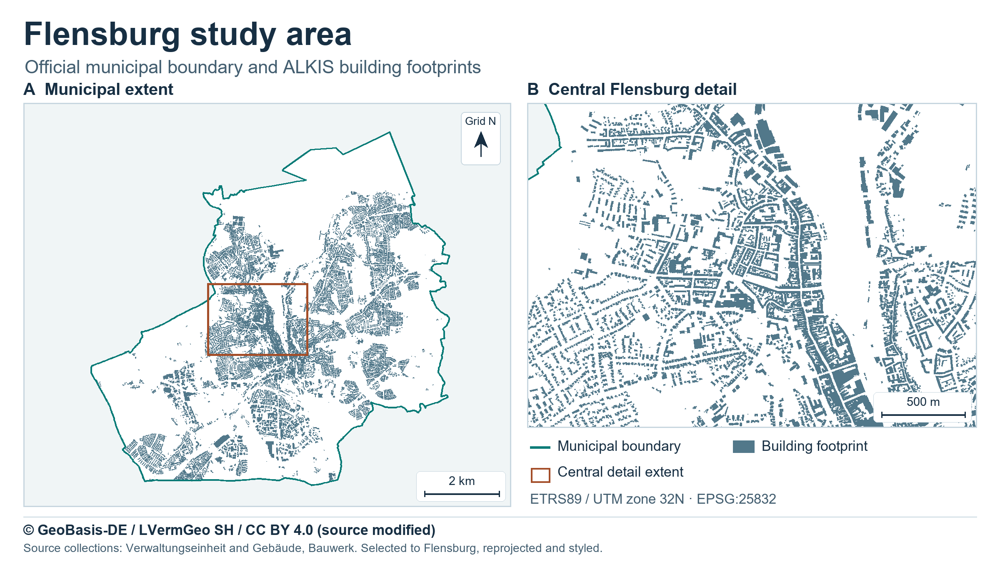
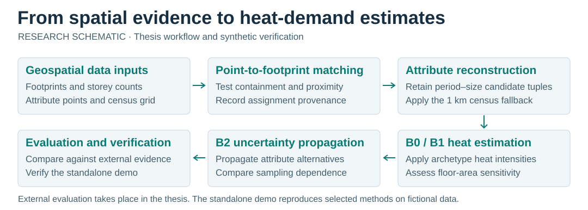
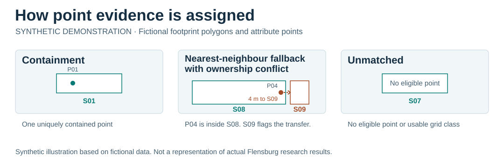
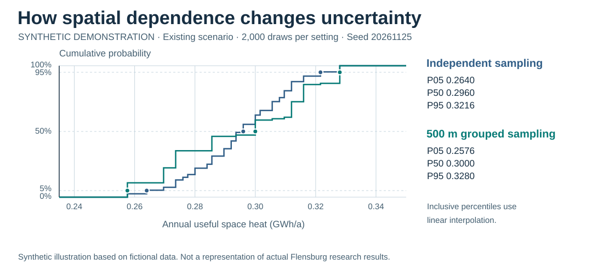
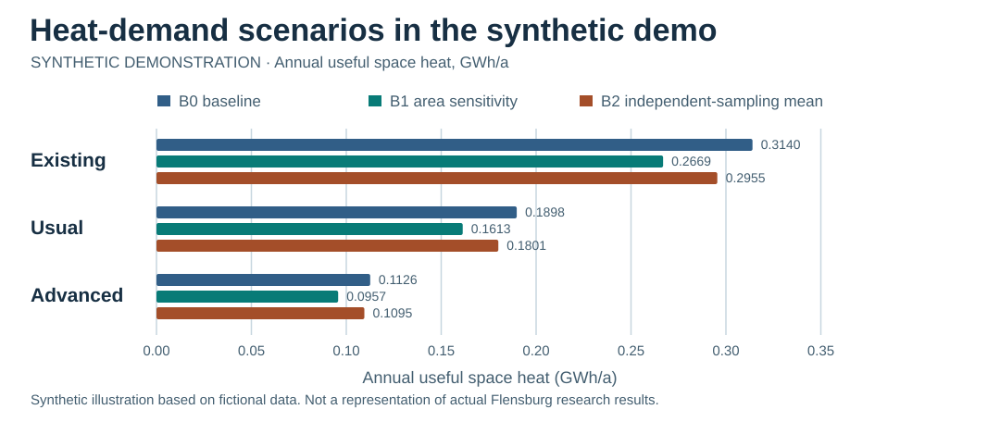

# Evidence-Conditioned Building-Level Residential Heat-Demand Mapping

## Research Overview

**Jianing Zhang · Technical University of Munich · MSc ESPACE · 2026**

How can incomplete spatial evidence support building-level estimates of annual useful space-heating demand? My MSc thesis, *Urban Building Energy Mapping and the Development of a Baseline Heat Demand Dataset*, investigated this question in Flensburg, Germany. It combined official building geometry, candidate attributes and census statistics with reference heat intensities, then examined area sensitivity and uncertainty under different spatial dependence assumptions.

The repository provides a standalone Python demonstration of selected methods on fictional buildings. Figure 1 uses official Flensburg geography solely to locate the study area. Figure 2 is a methodological schematic, and Figures 3–5 use fictional inputs. Every heat-demand value in the repository comes from the synthetic demonstration.

## Research Contributions

**Spatial evidence matching.** The workflow links attribute points to building footprints using containment and bounded proximity. It records the assignment route and flags transfers from points contained in a different footprint. This separates geometric attribution from the reliability of the attributes themselves.

**Attribute reconstruction.** The workflow preserves supported construction-period and size-class pairs and uses 1 km census age statistics as a fallback where point evidence is unavailable. The demo uses supplied candidate pairs and fallback inputs, and leaves buildings unresolved when the evidence is insufficient.

**Spatial uncertainty propagation.** The workflow carries uncertain attributes into aggregate annual useful space-heating estimates. The demo compares independent draws of construction-period classes with a 500 m block scenario that shares sampling ranks within each block. This comparison measures sensitivity to a specified spatial dependence assumption.

## Study Area



*Figure 1. Official Flensburg municipal boundary and building footprints from the surrounding study-area extract, shown at municipal scale and in a city-centre inset. Both panels use ETRS89 / UTM zone 32N (EPSG:25832). The inset makes the footprint pattern legible at neighbourhood scale.*

**Map attribution** © GeoBasis-DE / LVermGeo SH / CC BY 4.0 (Quelle verändert). The two layers were subsetted, reprojected and styled. [Municipal boundary collection](https://dienste.gdi-sh.de/ogcapi_aaa/alkis-vereinf-gid7/v1/collections/verwaltungseinheit?f=json) · [Building footprint collection](https://dienste.gdi-sh.de/ogcapi_aaa/alkis-vereinf-gid7/v1/collections/gebaeude_bauwerk?f=json) · [CC BY 4.0](https://creativecommons.org/licenses/by/4.0/) · [Provider terms](https://geodaten.schleswig-holstein.de/gaialight-sh/_apps/dladownload/lizenz.html) · [Layer provenance and licence inventory](docs/figure-sources-and-licences.md)

## Methodological Framework



*Figure 2. Schematic of the thesis workflow from spatial evidence integration to evaluation. The thesis compares selected outputs with external observations at the scale of each source. The standalone demo reproduces selected methods using fictional inputs.*

The thesis uses official building geometry, candidate attributes from ETHOS.BUILDA, Zensus 2022 age statistics at 1 km resolution, and TABULA reference intensities. Its reconstruction and evaluation distinguish geometric assignment consistency, reconstruction against withheld source labels, and comparisons to external observations.

## Spatial Matching



*Figure 3. P04 lies inside S08 but is used as nearest-neighbour evidence for S09, triggering a cross-building ownership warning. Synthetic illustration based on fictional data. Not a representation of actual Flensburg research results.*

The middle panel uses the default synthetic fixture. P04 is 4 m from the S09 footprint, so the demo records `nearest_10m` for S09 with `owner_conflict=True`. The warning identifies a risk of transferring evidence between buildings. An independent reference would be needed to verify S09’s attributes.

The demo preserves supported construction-period and size-class pairs. For S07, the fallback looks for a dominant construction-period class in a fictional 1 km cell and uses a supplied fallback size when a class is available. A tie or missing cell can leave the building unresolved.

## Heat Demand Scenarios

For a building, the area proxy $A$ is footprint area in m² times the number of storeys. Let $q_s$ be the reference useful space-heating intensity for scenario $s$, in kWh/(m²·a). With one candidate, $H_{B0,s}=Aq_s$. With multiple candidates, B0 averages the candidate intensities with equal area shares. B1 keeps the same attributes and uses $H_{B1,s}=0.85 H_{B0,s}$. The formulas give kWh/a. The output converts to MWh/a per building and GWh/a after aggregation.

Existing, Usual and Advanced specify different reference intensities. B0, B1 and B2 test different assumptions within each of those scenarios.

## Uncertainty Propagation

B2 retains the baseline area. It samples whole year–size tuples for multi-candidate buildings and propagates supplied uncertain year classes or specified size alternatives where applicable. Independent sampling draws a separate year rank per building. The grouped setting shares a rank within each 500 m block, with each building applying its own year probabilities. The grouped case tests the effect of co-movement on the aggregate.



*Figure 4. Empirical cumulative distributions of aggregate annual useful space-heating demand in the Existing scenario. Both sampling settings use 2,000 draws from the simulation initialised with seed 20261125. Markers show inclusive empirical percentiles P05, P50 and P95. Synthetic illustration based on fictional data. Not a representation of actual Flensburg research results.*

All three percentiles use the same draw totals in GWh/a and Python’s `statistics.quantiles(values, n=100, method="inclusive")`. For a percentile expressed as a fraction `p`, sort the `N` totals in ascending order, retaining ties, and compute the zero-based position `(N − 1) × p`. Use the value at an integer position or linearly interpolate between its two neighbouring values. P05, P50 and P95 use `p` values of 0.05, 0.50 and 0.95, respectively.

The intervals describe the specified simulation. Grouped sampling widens the synthetic central 90% range from 0.0576 to 0.0704 GWh/a.

## Synthetic Demonstration Results



*Figure 5. Aggregate annual useful space-heating demand for the Existing, Usual and Advanced scenarios, comparing the B0 baseline, B1 area sensitivity and B2 independent-sampling mean. Synthetic illustration based on fictional data. Not a representation of actual Flensburg research results.*

| Scenario | B0 (GWh/a) | B1 (GWh/a) | B2 independent-sampling mean (GWh/a) |
| --- | ---: | ---: | ---: |
| Existing | 0.31400 | 0.26690 | 0.29546 |
| Usual | 0.18980 | 0.16133 | 0.18010 |
| Advanced | 0.11260 | 0.09571 | 0.10952 |

Eight of ten fictional buildings contribute to the total. One lacks storey information and one has unresolved attributes. The fixture uses hypothetical intensities, supplied probabilities and a local metre grid. Scenario differences illustrate the effect of those assumptions. Differences in the B2 independent-sampling mean reflect the supplied attribute alternatives and the corresponding reference intensities.

## Reproducibility

Use Python 3.11 or newer. From the repository root run:

```bash
python -B src/demo.py --config configs/demo.json
python -B -m unittest discover -s tests -v
```

The demo and 21 tests use only the standard library. The CLI writes `outputs/demo-results.json` locally. On the reference Python 3.12.14 runtime the file is 6,685 bytes. See the [reproducibility guide](docs/reproducibility.md) for details and the reference SHA-256.

## Citation and Licence

Zhang, Jianing. (2026). *Urban Building Energy Mapping and the Development of a Baseline Heat Demand Dataset*. Master’s thesis, Technical University of Munich, Earth Oriented Space Science and Technology (ESPACE).

Thesis source credits include [OpenGBD](https://geodaten.schleswig-holstein.de/gaialight-sh/_apps/dladownload/), [ETHOS.BUILDA](https://ethos-builda.fz-juelich.de/), [Zensus 2022](https://www.destatis.de/DE/Themen/Gesellschaft-Umwelt/Bevoelkerung/Zensus2022/_inhalt.html), and [IEE Projekt TABULA / IWU](https://www.iwu.de/index.php?id=205).

Jianing Zhang developed the portfolio demonstration and showcase material with AI assistance. The author approved all five figures for public display in this repository. The [MIT licence](LICENSE) continues to cover the original V1.0 software and accompanying materials. The official geographic data in Figure 1 retain CC BY 4.0. The author reserves the rights they control in the original design elements of Figures 1–5. [Asset licences](ASSET_LICENSES.md)
